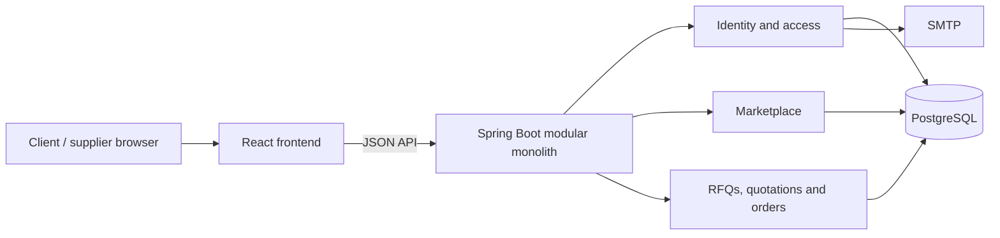

# Architecture

ProcureFlow is a B2B procurement application with identity, marketplace and procurement modules inside one Spring Boot application. Controllers expose JSON APIs, services own authorization and transactional business rules, repositories query PostgreSQL, and explicit DTOs define request and response contracts.

The frontend uses a React shell with JavaScript feature views and shared CSS. Vercel serves the frontend and rewrites `/api` requests to the backend. The backend is packaged as a Docker image and runs on Render; PostgreSQL stores business records and Flyway manages schema changes.

Accounts belong to organizations. A supplier profile owns published offerings. Client RFQs contain requirement items and supplier invitations; invitations connect suppliers to quotations. Acceptance creates an order with a snapshot of the agreed commercial details. Order events record fulfillment progress and the acting account.

## Correctness and security

- Server-side sessions, PBKDF2 password hashing, secure cookies and CSRF protection.
- Role grants and organization/participant-scoped queries protect private records.
- Transaction boundaries, row locks and database constraints protect quotation acceptance and repeated fulfillment commands.
- Orders progress through Created, Confirmed, Processing, Dispatched and Received with participant-specific actions.
- Comparisons group offers by currency and use decimal values; currencies are not implicitly converted.
- Session state is process-local. Multiple backend instances require an appropriate shared-session and revocation design before deployment.

## Patterns and development

The implementation uses modular-monolith and layered architecture, repositories, service-layer transactions, DTOs, constructor dependency injection, explicit state transitions, commercial snapshots and idempotent command handling. It was developed in iterative vertical slices with requirement-to-test traceability and review, using an adapted Agile V workflow and YAGNI/KISS principles.

AI-assisted extraction, drafting and supplier scoring are not implemented. The application does not currently provide a distributed load-balancing or rate-limiting setup.
