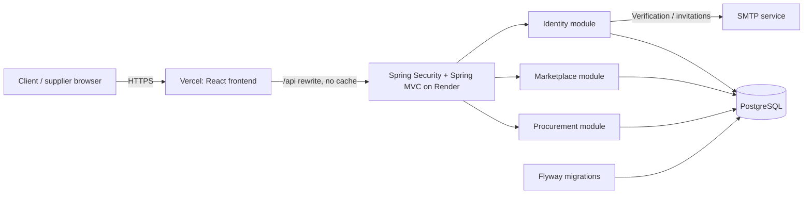
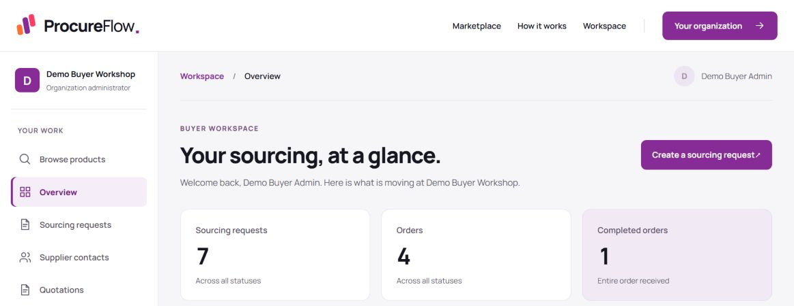

# ProcureFlow — portfolio case study

[Live application](https://procureflow-anonymnd.vercel.app) · [Production source](https://github.com/anonymnd/procureflow-ai/tree/codex/fsb-demo-production) · [Screenshots](screenshots/)

## Portfolio description

ProcureFlow is a full-stack B2B procurement application connecting clients and suppliers. It brings supplier discovery, requests for quotation (RFQs), supplier responses, quotation comparison, purchase orders and fulfillment tracking into one workspace. Separate client and supplier interfaces expose the actions permitted for each organization and account.

The project demonstrates end-to-end product development: domain modeling, REST APIs, organization-scoped authorization, transactional business rules, responsive interface design, database migrations, testing and cloud deployment. The implementation follows a modular-monolith architecture and an iterative, traceable delivery process.

## Implemented product capabilities

- Public supplier/product discovery and supplier publishing.
- Organization accounts, administrator/employee access and client/supplier grants.
- Private supplier contacts and multi-recipient RFQs with line items.
- Supplier quotation drafting/submission, commercial terms and validity dates.
- Comparison grouped by currency, with eligibility and lowest eligible subtotal indicators.
- Atomic quotation acceptance and an order snapshot of agreed commercial details.
- Whole-order tracking: Created → Confirmed → Processing → Dispatched → Received.
- Operational queues, deterministic analytics and role-specific dashboard summaries.
- Demo fixtures: six accounts, three organizations, twenty products, seven RFQs, six quotations and four orders. All are fictional; ordinary authentication remains enforced.

## Technology stack and deployment

| Layer | Implemented technology |
|---|---|
| Frontend | React 19, JavaScript, Vite 8, CSS, Manrope typography |
| Backend | Java 17, Spring Boot 4.1.1, Spring MVC, Spring Security |
| Persistence | Spring Data JPA/Hibernate, PostgreSQL, Flyway migrations |
| API | JSON REST endpoints, explicit request/view DTOs, Jakarta Validation |
| Authentication | Server-side HTTP sessions, PBKDF2 password hashing, CSRF protection |
| Delivery | Git/GitHub, Maven, npm, multi-stage Docker build |
| Hosting | Vercel frontend; Render containerized backend; hosted PostgreSQL |
| Verification | Spring/JUnit tests, database integration tests, browser checks, hosted HTTP/static-asset checks |

## System design

The backend is one deployable application, organized by business feature: `identity`, `marketplace` and `procurement`, with shared error handling in `common`. Within each module, controllers handle HTTP requests, services own business rules and transactions, repositories handle persistence, and models represent stored domain state. The React shell and existing JavaScript view/controller functions share frontend responsibilities; it is not described as a wholly componentized React rewrite.

Public terminology is **clients** (create sourcing requests) and **suppliers** (publish offerings and respond with quotations). Internal authorization names `BUYER` and `SUPPLIER` remain implementation details. The screenshots reproduce the preceding deployed UI and retain its earlier terminology and sample names. The Client/Supplier and realistic fictional name correction is reviewed at [02405ee](https://github.com/anonymnd/procureflow-ai/tree/codex/client-terminology); its production deployment and refreshed screenshots are pending because browser access is disabled. Do not present these images as proof that correction is live.

The browser uses same-origin `/api` URLs. Vercel rewrites them to the Render backend. Spring Security checks authentication and role grants, while service/repository queries constrain records to the current organization or permitted commercial participant. PostgreSQL is shared across organizations, using organization identifiers and application-enforced scoping rather than a separate database per tenant. Database TLS, HTTPS, secure session cookies and CSRF tokens protect the relevant boundaries.

### Core data relationships

- One organization has many accounts and client RFQs; it has at most one supplier profile, which owns many offerings.
- An RFQ has many required items and supplier invitations.
- An invitation connects a client RFQ to a supplier organization; its quotation has priced line items.
- An awarded RFQ has at most one purchase order; unique database constraints also protect the accepted quotation/order relationship.
- An order stores agreed details and item snapshots, and has multiple progress events recording actor and time.

### Important correctness decisions

Quotation acceptance runs in a transaction and locks the RFQ/related records. Repeating acceptance of the same winning quotation returns the existing order; attempting to choose a different winner conflicts. Unique constraints provide a second layer of duplicate protection.

Order progress uses explicit predecessor/target states and participant permissions. Supplier actions advance fulfillment; the client acknowledges receipt. Row locks and a unique `(order_id, target_status)` event constraint make repeated transitions safe. This is an audit history, not event sourcing: current state is stored on the order.

Comparison uses decimal monetary values and groups offers by currency; it does not invent foreign-exchange conversions. Dashboard summaries reuse existing tenant-scoped workspace queries. A failed optional summary displays unavailable data rather than a fabricated zero; expired authentication returns the user to sign-in.

## Architectural and design patterns actually used

| Pattern / technique | Concrete application |
|---|---|
| Modular monolith | Business feature modules inside one Spring Boot deployable |
| Layered architecture | Controller → service → repository → PostgreSQL |
| Repository pattern | Spring Data repositories and focused workspace/analytics query repositories |
| Service layer + transactional boundaries | RFQ submission, quotation acceptance and order transitions |
| DTO pattern | Explicit API request and response/view types keep persistence models off the API boundary |
| Dependency injection | Constructor-injected collaborators managed by Spring |
| State-transition modeling | Enumerated order actions with allowed predecessor/target states and actor checks |
| Snapshot pattern | Accepted commercial details copied into purchase-order records/items |
| Idempotent command handling | Existing award returned on replay; duplicate progress events prevented |
| Centralized exception handling | Consistent API errors through exception handlers |

The state-transition implementation is not a GoF State class hierarchy. The project does not need microservices, Kafka, Redis, Kubernetes, event sourcing or distributed CQRS to support its current scope.

## Development method

The repository uses an **adapted lightweight Agile V workflow**: small vertical feature slices paired with explicit verification. It is an iterative approach with V-model-style traceability, not a claim of Scrum certification or full formal V-model compliance.

The recorded flow is requirements and acceptance criteria → review → scoped approval → immutable requirement baseline → GitHub issue → separate implementation authorization → code and tests → separate-context review → corrections → acceptance → scoped deployment and hosted verification.

Requirements, decisions, issues, source paths and tests are linked in `.agile-v/`. `docs/code-reading-guide.md` explains implemented behavior. The approach applies YAGNI and KISS by extending existing APIs and responsible modules, keeping transactions and authorization explicit, and avoiding speculative infrastructure. Some historical slices explicitly record skipped reviews; do not claim every stage received an independent review.

## UI/UX work

The workspace redesign applies UI/UX Pro Max guidance to hierarchy, navigation, status communication, touch targets and responsive layout. It retains the purple brand and Manrope typeface, adds contextual breadcrumbs and organization identity, and replaces the overview button wall with real metrics, recent records and grouped workflow actions. Shared styles improve filters, cards, tables, comparison, order progress, profiles and team pages. Statuses include text, and focus states and local table scrolling support interaction across viewport sizes.

## Evidence and honest limits

Frontend release `021b048d94c9002bd29d466f3d58c9569a8ce27f` is the captured production redesign. The scoped hosted review verified served assets and public/authentication boundaries; ordinary client and supplier demo login was observed. Selected screenshots contain fictional demo data only and show native viewport/detail captures.

The Render Free backend can incur connection/cold-start delays. The canonical Vercel application has the new UI; Render's direct static fallback retains the preceding UI. Fresh email delivery remains deferred. AI-assisted drafting, document extraction and supplier scoring must not be presented as delivered features. Current analytics and comparisons are deterministic.

## Screenshot links

| Screen | Image |
|---|---|
| Client dashboard | [JPEG](screenshots/01-client-dashboard.jpg) |
| Supplier dashboard | [JPEG](screenshots/02-supplier-dashboard.jpg) |
| Supplier quotations | [JPEG](screenshots/03-quotations.jpg) |
| Marketplace | [JPEG](screenshots/04-marketplace.jpg) |
| Quotation comparison | [JPEG](screenshots/05-quotation-comparison.jpg) |
| Orders | [JPEG](screenshots/06-orders.jpg) |
| Order progress | [JPEG](screenshots/07-order-progress.jpg) |
| Operational queues | [JPEG](screenshots/08-operational-queues.jpg) |
| Supplier products | [JPEG](screenshots/09-supplier-products.jpg) |

## Short copy for a portfolio card

> **ProcureFlow — B2B Procurement Platform**
> A full-stack platform for supplier discovery, RFQs, quotation comparison and purchase-order tracking. Built with React, Spring Boot and PostgreSQL, with organization-scoped access, transactional award handling and responsive client/supplier dashboards. Delivered through iterative feature slices, requirement-to-test traceability, code review and cloud deployment.

Suggested tags: `Java` · `Spring Boot` · `React` · `PostgreSQL` · `REST API` · `Spring Security` · `Docker` · `Flyway` · `Modular Monolith` · `UI/UX` · `Agile V`.
